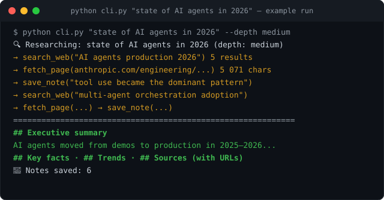

# Claude Research Agent

An autonomous web-research agent built on the **Claude API with multi-step tool use**. Give it a topic — it runs real web searches, reads the most relevant pages, accumulates notes, and returns a structured analytical report with sources.

Part of my portfolio: **[all 49 projects](https://github.com/artesuavee/portfolio)** · [live showcase](https://artesuavee.github.io/portfolio/)



## The problem

"Research topic X" means an hour of googling, skimming a dozen tabs and pasting fragments into a doc. An LLM alone can't do it — its knowledge is frozen at the training cutoff and it can't cite live sources. The agent needs real search, real page reading, and a disciplined report format.

## The solution

Claude plans and executes the research loop itself — deciding what to search, which pages to open, and what to remember:

```
Topic
  │
  ▼
┌─────────────┐  search_web   ┌───────────────────────────┐
│   Claude    │──────────────▶│ DuckDuckGo search (ddgs)   │
│  research   │  fetch_page   │ requests + BeautifulSoup   │
│    loop     │──────────────▶│ page → readable text       │
│ (≤10 steps) │  save_note    │ notes accumulator          │
└─────────────┘◀──────────────└───────────────────────────┘
  │
  ▼
Report: summary · key facts · trends · sources
```

- **`search_web`** — live DuckDuckGo search via `ddgs` (no API key needed), titles/URLs/snippets as JSON.
- **`fetch_page`** — fetches the page, strips scripts/nav/boilerplate, returns clean text (truncated to fit context).
- **`save_note`** — the agent's working memory across steps; notes are returned alongside the report.
- **Depth control** — `quick` / `medium` / `deep` caps the tool-use steps (3 / 6 / 10), trading cost for coverage.

The tool loop lives in [`claude_client.py`](claude_client.py) — a ~80-line reusable wrapper (history, system prompt, multi-step tool calling) with no framework dependencies.

## Quick start

```bash
pip install -r requirements.txt
cp .env.example .env        # add your ANTHROPIC_API_KEY
python cli.py "state of AI agents in 2026" --depth medium
```

### Optional Parallel search

Use [Parallel Search MCP](https://docs.parallel.ai/integrations/mcp/search-mcp)
for free web search in Fast mode, with no Parallel account or API key:

```bash
pip install -r requirements-parallel.txt
# Set SEARCH_PROVIDER=parallel in .env, or select it for one run:
SEARCH_PROVIDER=parallel python cli.py "state of AI agents in 2026" --depth medium
```

The existing `search_web` tool returns the same titles, URLs and snippets, using
Parallel's relevant excerpts as snippets. DuckDuckGo remains the default; set
`SEARCH_PROVIDER=duckduckgo` to switch back. Page fetching and notes keep their
existing behavior. The optional backend uses the MCP SDK's Streamable HTTP
transport to `https://search.parallel.ai/mcp`, with a 15-second search timeout.
Search errors (including free-tier rate limits) are returned to the agent without
switching providers. The Claude API key from the quick start is still required
for research reports.

To try only the search tool without a Claude API key:

```bash
SEARCH_PROVIDER=parallel python -c 'from tools import search_web; print(search_web("Python asyncio documentation", max_results=3))'
```

## Example run

```
🔍 Researching: state of AI agents in 2026 (depth: medium)

============================================================
## Executive summary
AI agents moved from demos to production in 2025-2026, with tool
use and multi-agent orchestration becoming the dominant pattern...

## Key facts
- ...

## Sources
1. https://...
2. https://...

📝 Notes saved: 6
```

## Stack

Python 3.10+ · Anthropic SDK · tool use (function calling) · ddgs · requests + BeautifulSoup · zero frameworks

## Adapting to production

| Demo piece | Production replacement |
|---|---|
| DuckDuckGo (`ddgs`) | Search API (Brave / Tavily / SerpAPI) |
| In-memory notes | Vector store / database for long-running research |
| CLI output | Scheduled digests to Slack / Telegram / email |

---
**Idris** · Telegram [@chief_irs](https://t.me/chief_irs) · [portfolio](https://artesuavee.github.io/portfolio/)
